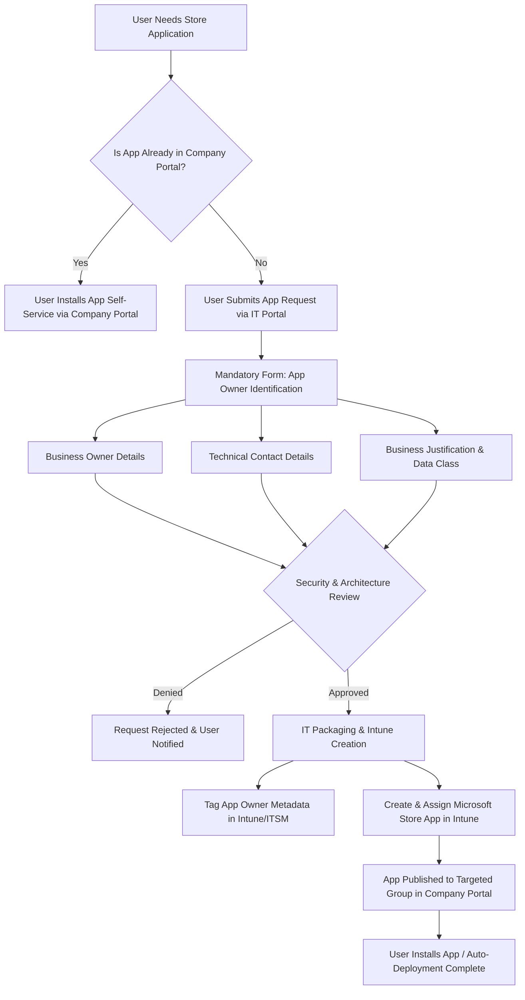
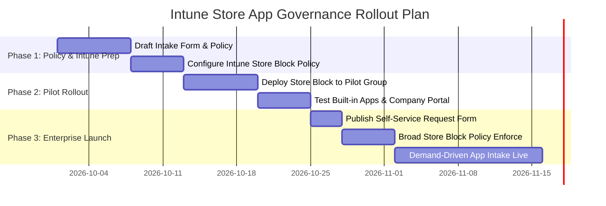

# Executive Proposal: Intune Store App Governance & Demand-Driven Application Ownership Strategy

**Document Version:** 1.0  
**Prepared For:** IT Leadership, Endpoint Management Committee, Security & Compliance  
**Subject:** Proactive Control Strategy for Microsoft Store Apps & Just-in-Time Application Owner Identification in Microsoft Intune  

---

## 1. Executive Summary

As organizations transition to modern device management with Microsoft Intune, managing application lifecycles and software governance becomes a critical security and operational priority. 

The standard approach of pre-creating Microsoft Store applications in Intune without established application owners creates **unmanaged catalog bloat, compliance risks, and undefined support boundaries**. 

This document proposes a **proactive, two-phase governance strategy**:
1. **Immediate Hardening:** Restrict direct, unmanaged user access to the public Microsoft Store on corporate endpoints using Intune configuration policies.
2. **Just-In-Time (JIT) Application Intake & Ownership:** Require an explicit **Application Owner (Business & Technical Contact)** and justification *before* any Microsoft Store application is packaged, created, or assigned in Intune.

```
+-----------------------------------------------------------------------------------+
|                            PROPOSED GOVERNANCE MODEL                              |
+-----------------------------------------------------------------------------------+
|  [ 1. BLOCK PUBLIC STORE ]  ==>  [ 2. USER REQUESTS APP ] ==>  [ 3. ASSIGN OWNER ]|
|  Eliminate Shadow IT             Company Portal / ITSM         Mandatory Data     |
|  & Unvetted Downloads            Intake Portal                 Captured Upfront   |
|                                                                        ||         |
|  [ 5. SELF-SERVICE DELIVERY ] <== [ 4. IT PACKAGES IN INTUNE ] <=======++         |
|  Assigned via Company Portal       WinGet / New Store Integration                 |
+-----------------------------------------------------------------------------------+
```

### Key Executive Value Highlights:
* **Zero Shadow IT Risk:** Blocks unauthorized, unvetted software downloads across all managed Windows endpoints.
* **100% Application Accountability:** Every app published in Intune has an identified owner accountable for licensing, support, and business justification from day one.
* **Zero Disruption to Productivity:** Users continue to request needed apps via standard IT service catalog/Company Portal workflows.
* **Elimination of Governance Debt:** Prevents IT from inheriting hundreds of orphaned applications with unknown business owners.

---

## 2. Problem Statement: The Risk of Pre-Creating Apps Without Owners

Attempting to assign app owners *after* pre-populating Store apps in Intune creates significant operational and security vulnerabilities:

| Challenge / Risk | Impact of Pre-Populating Apps Without Owners | Impact of Proposed Strategy (Block & JIT Ownership) |
| :--- | :--- | :--- |
| **Shadow IT & Unvetted Software** | Users install arbitrary store apps (games, proxy tools, unapproved utilities) bypassing security review. | Public Store is blocked; only vetted apps are published via Company Portal. |
| **Orphaned Applications** | Apps exist in Intune with no known contact for security alerts, vendor changes, or lifecycle updates. | 100% of apps have defined Business & Technical Owners before deployment. |
| **Catalog Bloat** | Intune tenant accumulates dozens of single-use apps that become stale and unmaintained. | Apps are published only on validated business demand. |
| **Unclear Support Responsibilities** | IT Helpdesk is blamed for issues with specialized line-of-business (LOB) apps they don't support. | App Owner is explicitly designated as Tier 3 / Vendor liaison. |
| **Licensing Compliance** | Free store apps convert to paid versions or require account logins without IT oversight. | App Owner confirms licensing model prior to Intune assignment. |

---

## 3. The Two-Phase Strategic Solution

### Phase 1: Proactive Store Control (Preventative Hardening)

Instead of attempting to catalogue and assign owners to thousands of public Store applications retroactively, IT enforces a baseline security control by restricting direct user access to the consumer Microsoft Store.

#### How It Works:
* **Block Public Store Access:** Apply Intune Settings Catalog policies (`Turn off the Store application`) to corporate endpoints.
* **Preserve System Components:** Windows built-in app updates (Calculator, Photos, Notepad, etc.) continue to update seamlessly via background servicing channels without requiring public Store access.
* **Enable Curated App Delivery:** Use **Microsoft Intune Company Portal** as the single source of truth for approved software.

> [!NOTE]
> Blocking the public Microsoft Store **does not** prevent IT from deploying Microsoft Store (new) apps via Intune. IT uses the Windows Package Manager (WinGet) infrastructure integrated into Intune to deploy approved Store apps safely.

---

### Phase 2: Demand-Driven Application Intake & Owner Identification Workflow

When a user or department requires a specific Microsoft Store application:

1. **Service Request Initiation:** User submits a request via the ITSM portal (ServiceNow, Jira Service Management, or custom PowerApp).
2. **Mandatory App Owner Identification:** The request cannot be processed without specifying:
   * **Business Owner:** Department manager or lead responsible for business justification & license funding.
   * **Technical Contact / SME:** Subject Matter Expert responsible for testing updates and defining user targeted groups.
   * **Application Metadata:** Business purpose, data classification, and targeted user group.
3. **Security & Compliance Review:** Automated or quick-turn review based on risk tier.
4. **App Deployment in Intune:** IT creates the **Microsoft Store app (new)** object in Intune, tags the App Owner metadata, and assigns it to the designated Entra ID group or Company Portal.

---

## 4. End-to-End Operational Workflow

The following Mermaid diagram outlines the end-to-end request, governance, and deployment process:



---

## 5. Technical Architecture & Intune Implementation Details

### A. Blocking Public Store Access in Intune

To enforce the control, configure the following policy in Intune:

* **Policy Type:** Configuration Profile -> Settings Catalog
* **Category:** Administrative Templates > Windows Components > Store
* **Setting:** `Turn off the Store application` -> **Enabled**
* **Alternative/Complementary Setting:** `Require Private Store only` (if applicable) or `User Account Control / AppLocker / WDAC` policies for Store app installation restriction.

> [!TIP]
> **Company Portal Experience:** When this policy is enabled, users opening the Microsoft Store app see a message stating *"Microsoft Store is blocked by your organization"*. However, opening the **Company Portal** allows seamless one-click installation of IT-approved apps!

---

### B. Deployment of Microsoft Store Apps (New) via Intune

When deploying approved Store apps post-intake:
* **App Type:** `Microsoft Store app (new)` (powered by WinGet).
* **Benefits:**
  * Direct repository search within Intune admin center.
  * Automatic system-context or user-context installation.
  * Background automatic updates managed by Intune and Windows update agent.
  * No standard user local admin rights required.

---

### C. Required App Owner Metadata Schema

Every application record registered in ITSM / Intune documentation must maintain the following governance fields:

| Field Name | Type | Description / Example |
| :--- | :--- | :--- |
| **App Name & ID** | String | e.g., Power BI Desktop (WinGet ID: 9NTXR16HNW1T) |
| **Business Owner** | User / Email | Jane.Doe@company.com (Finance Lead) |
| **Technical SME** | User / Group | john.smith@company.com / App-Finance-Support |
| **Business Justification** | Text | Required for quarterly financial reporting |
| **Target Audience** | Entra ID Group | `GRP-APP-PowerBI-Users` |
| **Security Risk Rating** | Enum | Low / Medium / High (Data Sensitivity) |
| **Review Date** | Date | Annual re-certification date |

---

## 6. RACI Responsibility Matrix

| Phase / Task | Requestor | App Business Owner | Technical SME | Intune Admin | Security Team |
| :--- | :---: | :---: | :---: | :---: | :---: |
| Block Store Access Policy | I | I | I | **A / R** | C |
| Submit New Store App Request | **R** | C | C | I | I |
| Provide App Owner & Metadata | C | **A / R** | R | I | I |
| Security & Risk Assessment | I | I | C | I | **A / R** |
| Create & Assign App in Intune | I | I | I | **A / R** | I |
| UAT & Application Testing | Testing | **A** | **R** | C | I |
| Annual App Access Review | I | **A / R** | C | C | C |

*Legend: **R** = Responsible, **A** = Accountable, **C** = Consulted, **I** = Informed*

---

## 7. Stakeholder Objection Handling & Management FAQ

To ensure smooth approval from leadership, address common questions proactively:

### Q1: "Won't blocking the Microsoft Store cause end-user frustration and support tickets?"
> **Answer:** No. Standard users rarely use the public Store for legitimate work tools. By pre-populating common productivity apps (Power BI, Adobe Reader, Zoom, Slack) in the Company Portal and providing a simple 2-minute request form for new apps, users get a superior self-service experience without admin rights prompts.

### Q2: "Why can't IT just create all Microsoft Store apps now and find owners later?"
> **Answer:** Finding owners retroactively fails in practice. Applications without owners become "ghost apps" when security vulnerabilities are discovered or when software contracts change. Mandating owner identification *at request time* takes zero extra effort from IT and transfers accountability to the requesting business unit where it belongs.

### Q3: "What happens to built-in Windows applications like Calculator, Snipping Tool, or Photos?"
> **Answer:** Core Windows apps are inbox components. Blocking the consumer Store application does **not** stop built-in system apps from working or receiving security updates via Windows Update / DISM servicing channels.

### Q4: "How does this scale for enterprise app management?"
> **Answer:** This approach scales infinitely. IT becomes an enabler (packaging vetted requests) rather than a bottleneck trying to audit thousands of unmanaged Store apps across thousands of endpoints.

---

## 8. Implementation Roadmap



### Detailed Phases:

* **Week 1-2 (Phase 1: Foundation):**
  * Publish the App Intake Form (ITSM/ServiceNow) with mandatory App Owner fields.
  * Create the Store Blocking Settings Catalog policy in Intune.
* **Week 3 (Phase 2: Pilot & Validation):**
  * Apply policy to IT & Pilot user groups (100-500 endpoints).
  * Verify Company Portal app delivery and system app stability.
* **Week 4+ (Phase 3: Production Enforcement):**
  * Broadcast user communication regarding Company Portal as the software hub.
  * Enable Store block policy organization-wide.
  * Operate on 100% Demand-Driven Application Governance.

---

## 9. Recommendation & Decision Request

It is recommended that management approve the **Proactive Store App Blocking & Demand-Driven Owner Identification Policy**. 

### Action Required by Committee:
1. **Approve Policy Principle:** Approve blocking public Microsoft Store direct access on corporate endpoints.
2. **Approve Governance Requirement:** Mandate Business & Technical Owner designation as a prerequisite for Intune app publishing.
3. **Authorize Pilot Rollout:** Authorize IT Endpoint Management to begin Phase 1 pilot implementation.

---
*End of Proposal Document.*
